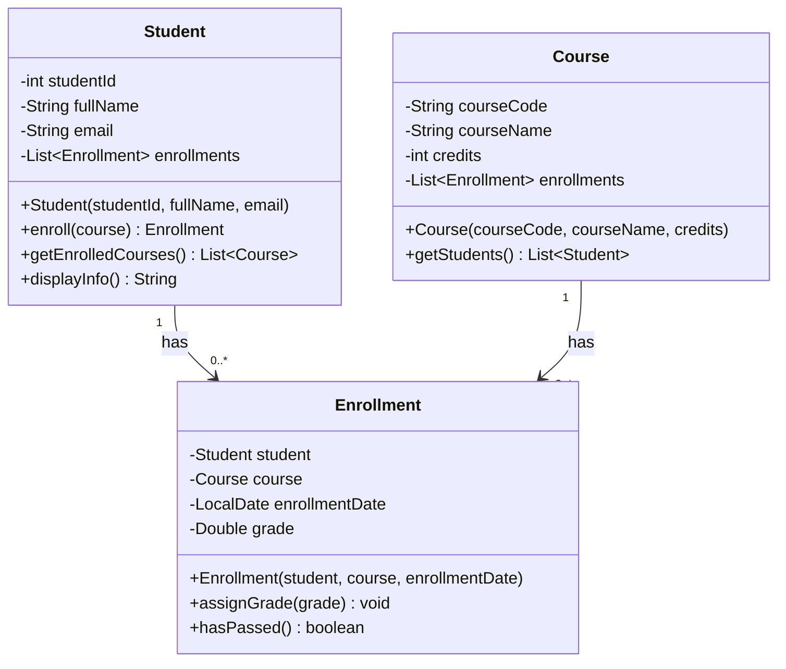

# Assignment 003 — Student Class Diagram

This project maps a student class diagram to Java code. It demonstrates
encapsulation, associations between classes, validation, and a many-to-many
relationship implemented through an `Enrollment` class.

## Class diagram

## Design summary

- `Student` stores student information and enrolls in courses.
- `Course` stores course information and exposes its enrolled students.
- `Enrollment` connects one student to one course and stores enrollment data.
- Private fields and public methods follow the visibility shown in the diagram.
- Constructor and method validation prevent invalid objects and duplicate enrollment.